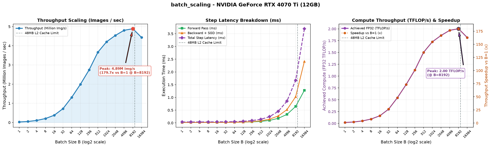
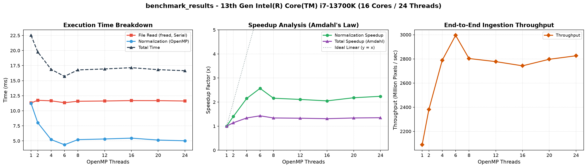
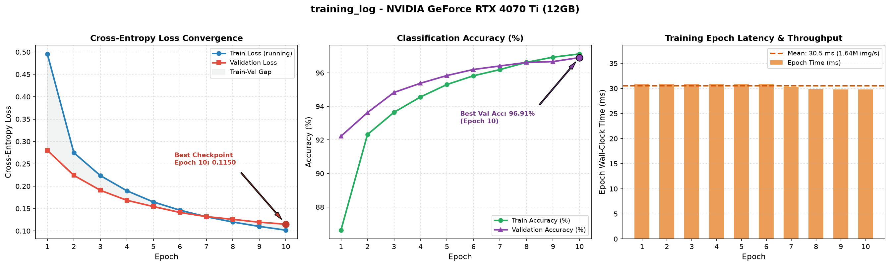

# MNIST CUDA Engine

A zero-dependency C11, CUDA, and OpenMP neural network training engine and hardware benchmarking suite built from scratch—without cuBLAS, cuDNN, or high-level ML frameworks.

This project implements a complete multi-layer perceptron (`784 -> 128 -> 10`) directly in custom CUDA C++ kernels and OpenMP-accelerated C routines to establish a clean, mathematically verified baseline for studying GPU execution behavior, memory hierarchy effects, and CPU-GPU system performance.

---

## Key Baseline Metrics

Measured on **NVIDIA GeForce RTX 4070 Ti** (`sm_89`, 60 SMs, 48 MB L2 cache, 12 GB GDDR6X) and **13th Gen Intel Core i7-13700K** (16 cores / 24 threads):

| Benchmark / Workload | Key Result | Details |
| :--- | :--- | :--- |
| **End-to-End MLP Training** | **~30.4 ms / epoch** (`0.30s` total) | 10 epochs, `B = 100`, `50k` train / `10k` val (`~1.64M img/s`) |
| **Model Generalization** | **96.65% Test Accuracy** | Locked `10k` test set (`96.91%` best validation checkpoint) |
| **Peak GPU Kernel Throughput** | **4.89M images/sec** (`2.00 TFLOP/s`) | `179.7x` speedup at `B = 8192` vs. `B = 1` (`cudaEvent_t` timing) |
| **CPU OpenMP Ingestion** | **2,995 Mpix/s** (`15.71 ms` for `60k` imgs) | `2.57x` normalization speedup (`1.43x` Amdahl-bounded total at 6 threads) |
| **Numerical Verification** | **`< 1e-4` max absolute error** | All 11 forward, backward, init, and SGD kernels vs. CPU reference |

---

## Project Goal

The purpose of this repository is twofold:
1. **Build a transparent, verified baseline from first principles** — implementing forward/backward matrix operations, activations, numerically stable loss functions, weight initialization, data ingestion, and hardware event timers directly in C and CUDA.
2. **Investigate and optimize performance bottlenecks** — using this baseline as an experimental testbed to analyze where execution time is spent across the GPU and CPU, identify hardware bottlenecks empirically, and research optimization techniques to reduce compute and data-movement overhead.

---

## Architecture & Numerical Design

### Network Topology (`101,770` FP32 Parameters)
`Input (784)` $\rightarrow$ `Linear (784x128) + Bias` $\rightarrow$ `ReLU` $\rightarrow$ `Linear (128x10) + Bias` $\rightarrow$ `Max-Shifted Softmax`

### Custom CUDA Kernel Library ([`include/layers.cuh`](include/layers.cuh), [`src/layers.cu`](src/layers.cu))
* **Initialization & Batching**: `k_init_weights_he` (`cuRAND` device API drawing from $\mathcal{N}(0, \sqrt{2 / n_{\text{in}}})$), `k_gather_batch` (on-GPU mini-batch gathering via shuffled index arrays).
* **Forward Pass**: `k_forward_linear`, `k_relu`, `k_softmax`, `k_cross_entropy_loss`.
* **Backward Pass & Optimizer**: `k_cross_entropy_backward` (fused Softmax + Cross-Entropy gradient $\frac{\partial \mathcal{L}}{\partial z} = p - y$), `k_compute_dw`, `k_compute_db`, `k_compute_da`, `k_relu_backward`, `k_sgd_update`.

### Floating-Point Numerical Stability & Evaluation Rigor
* **Overflow-Safe Softmax**: Subtracts per-sample row maximum $\max_j z_{i,j}$ prior to exponentiation (`expf(z - max_val)`), guaranteeing bounded inputs $(\le 0)$ and preventing `Inf`/`NaN` overflow in FP32.
* **Log-Underflow Guard**: Clamps predicted probabilities via `fmaxf(p, 1e-7f)` inside cross-entropy evaluation (`-logf(...)`) so zero-probability predictions never poison loss reductions.
* **Untrained Entropy Sanity Check**: Verifies Step-0 validation loss (`2.2655`) against theoretical uniform 10-class entropy ($\ln(10) \approx 2.3026$) prior to parameter updates.
* **Strict Data Hygiene**: Splits the `60,000` training set into `50,000` training and `10,000` validation samples, checkpoints the lowest validation loss weights to `models/mnist_mlp_weights.bin`, and evaluates the `10,000`-image test set once at completion.

---

## Experimental Benchmarks & Hardware Findings

### 1. GPU Batch-Size Scaling & L2 Cache Spill (`B = 1` to `16,384`)

[`benchmarks/gpu_benchmarks/bench_batch_size.cu`](benchmarks/gpu_benchmarks/bench_batch_size.cu) sweeps batch sizes in powers of two using hardware `cudaEvent_t` timers (`50` warmup + `200` measured steps per batch size) and exact step FLOP accounting ($409{,}680 \cdot B + 305{,}310$ FLOPs).



**Observed Hardware Regimes:**
1. **Kernel Launch Overhead Bound (`B = 1 .. 32`)**: Total step time remains nearly flat (`0.0368 ms` to `0.0445 ms`) across a `32x` increase in work. With 15 kernel launches per training step (`~2.5 us` launch latency per kernel), execution is dominated by dispatch overhead rather than SM arithmetic.
2. **48 MB L2-Resident Scaling (`B = 64 .. 8,192`)**: As thread blocks saturate the 60 SMs and intermediate activations/gradients remain resident inside the RTX 4070 Ti's **48 MB L2 cache** (`~42 MB` working set at `B = 8,192`), throughput climbs to **`4.89M images/sec`** (`179.7x` speedup over `B = 1`) and **`2.00 FP32 TFLOP/s`**. Peak throughput reaches `~5%` of the GPU's theoretical FP32 ceiling, highlighting the memory-traffic cost of naive global-memory matrix multiplication and sequential $O(B)$ gradient accumulation loops.
3. **L2 Cache Capacity Spill (`B = 16,384`)**: Doubling the batch to `16,384` expands the active tensor working set to `~85 MB`, exceeding the 48 MB L2 cache and spilling traffic to GDDR6X VRAM. Backward pass latency jumps **`2.35x`** (`1.03 ms` $\rightarrow$ `2.42 ms`), causing net throughput to drop to `4.43M images/sec` (`1.82 TFLOP/s`).

---

### 2. CPU OpenMP Ingestion: Amdahl's Law & Memory-Bandwidth Saturation

[`benchmarks/cpu_benchmarks/bench_dataset.c`](benchmarks/cpu_benchmarks/bench_dataset.c) separates sequential binary file reading (`fread`) from parallel `uint8 -> float32` pixel normalization (`47.04M` pixels across `60,000` images) across `1` to `24` OpenMP threads after warming the OS page cache.



**Observed Hardware Behavior:**
* **Memory-Bandwidth Wall at 6 P-Cores**: Pixel normalization (`out[i] = raw[i] * (1.0f / 255.0f)`) reads 1 byte and writes 4 bytes per FLOP (`0.20 FLOP/byte` arithmetic intensity). Normalization time drops from `11.23 ms` (1 thread) to **`4.36 ms` at 6 threads (`2.57x` speedup, `~54 GB/s` sustained read+write bandwidth)**, then plateaus across `8–24` threads once dual-channel DDR5 bandwidth is saturated.
* **Exact Amdahl's Law Ceiling**: Sequential `fread` from the page cache remains flat at `~11.3–11.7 ms` (`50.1%` of single-thread runtime). With serial fraction $f_s = 0.501$ and parallel speedup $S_p = 2.57\times$, Amdahl's Law predicts $S_{\text{total}} = \frac{1}{0.501 + 0.499 / 2.57} = 1.44\times$, matching the measured **`1.43x` end-to-end speedup** (`2,995 Mpix/s`).

---

### 3. Training Convergence Dynamics

[`main.cu`](main.cu) logs per-epoch training metrics, validation metrics, and hardware epoch latency to `benchmarks/training_log.csv`.



Note that Epoch 1 running training loss (`0.4957`) exceeds end-of-epoch validation loss (`0.2801`) because training loss averages over all 500 online SGD steps (starting near $\ln(10) \approx 2.30$), whereas validation evaluates the post-epoch weights. By Epoch 7, online training loss crosses below validation loss while validation accuracy continues improving monotonically to **`96.91%`** at Epoch 10 (`96.65%` on the locked `10,000`-image test set).

---

## Interactive Inference Demo

[`predict.cu`](predict.cu) loads the saved binary checkpoint (`models/mnist_mlp_weights.bin`) and executes single-sample GPU inference on any test image (`0..9999` or `random`):

```text
$ make predict 0
=========================================================
   MNIST CUDA Inference Engine - Interactive Predictor   
=========================================================
  Test Image Index: #0

  Predicted Class Probabilities:
  ---------------------------------------------------------
  Digit 0: [                                    ]   0.00%
  Digit 1: [                                    ]   0.00%
  Digit 2: [                                    ]   0.04%
  Digit 3: [                                    ]   0.19%
  Digit 4: [                                    ]   0.00%
  Digit 5: [                                    ]   0.00%
  Digit 6: [                                    ]   0.00%
  Digit 7: [################################### ]  99.74% <== PREDICTION
  Digit 8: [                                    ]   0.00%
  Digit 9: [                                    ]   0.02%
  ---------------------------------------------------------
  Result:       [CORRECT]
  Ground Truth: Digit 7
  Prediction:   Digit 7 (Confidence: 99.74%)
```

---

## Repository Structure

```text
mnist-cuda-engine/
├── include/
│   ├── dataset.h                         # Host dataset loader API & timing struct
│   └── layers.cuh                        # CUDA forward, backward, init & optimizer API
├── src/
│   ├── dataset.c                         # OpenMP static-scheduled pixel normalization & one-hot encoding
│   └── layers.cu                         # Custom FP32 CUDA kernels
├── tests/
│   ├── test_dataset.c                    # Bounds, one-hot invariants & header ground-truth tests
│   ├── test_forward_kernels.cu           # CPU-reference parity tests (< 1e-4) for forward & He init kernels
│   └── test_backward_kernels.cu          # CPU-reference parity tests (< 1e-4) for backward & SGD kernels
├── benchmarks/
│   ├── cpu_benchmarks/                   # OpenMP thread-scaling benchmark (C source, CSV & plot)
│   ├── gpu_benchmarks/                   # CUDA batch-scaling benchmark (CUDA source, CSV & plot)
│   ├── training_log.csv                  # Per-epoch loss, accuracy & latency telemetry
│   └── training_log.png                  # Learning-curve & epoch-latency visualization
├── scripts/
│   ├── plot_benchmark.py                 # CPU scaling & Amdahl's Law plotter
│   ├── plot_gpu_benchmark.py             # GPU latency, throughput & TFLOP/s plotter
│   └── plot_training.py                  # Training convergence plotter
├── data/
│   └── download_mnist.py                 # Downloads & strips IDX headers into flat binary files
├── main.cu                               # End-to-end GPU training & validation/test pipeline
├── predict.cu                            # CLI single-image GPU inference & ASCII visualizer
└── Makefile                              # Build, test, training, inference & benchmark targets
```

---

## Quick Start & Reproducibility

### Prerequisites
* **CUDA Toolkit** (`nvcc` — update `CUDA_ARCH` in [`Makefile`](Makefile) for your GPU architecture; default `-arch=sm_89` targets Ada Lovelace)
* **GCC** with OpenMP support (`-fopenmp`)
* **Python 3** with `pandas` and `matplotlib` (for dataset download and benchmark plots)

### Commands

```bash
# 1. Download raw MNIST binary files into data/
python3 data/download_mnist.py

# 2. Run unit test suites (dataset loader + forward/backward CUDA kernels)
make test_dataset
make test_kernels

# 3. Train the MLP on GPU, checkpoint best weights, evaluate locked test set, and plot learning curves
make run

# 4. Run interactive single-image GPU inference (pass 0..9999 or omit for random)
make predict 0
make predict

# 5. Reproduce CPU OpenMP and GPU batch-scaling benchmarks + plots
make bench_dataset
make bench_gpu
```
